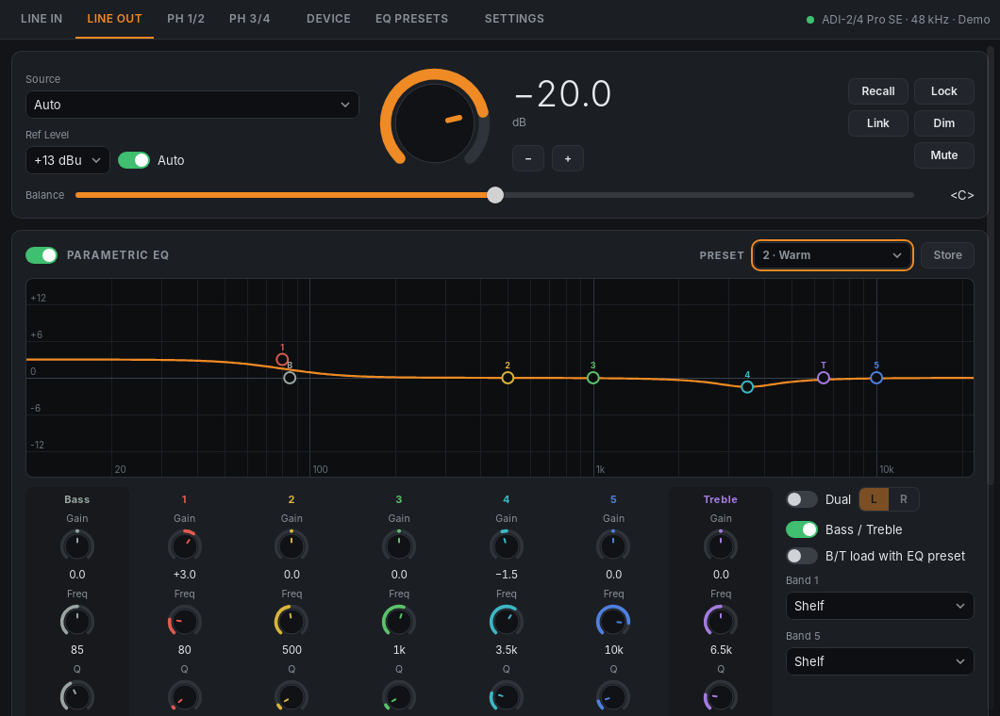

# Open ADI-2 Control

Remote control for RME ADI-2 series converters on Linux: ADI-2 DAC, ADI-2 Pro, ADI-2/4 Pro SE
and their FS/EX versions. It talks to the unit over its USB-MIDI port, the same way RME's ADI-2
Remote does on Windows, macOS and iPadOS.

Not affiliated with RME.



## Features

- **Outputs** (Line Out, Phones 1/2, Phones 3/4; ADI-2 DAC: Line Out, Phones, IEM): source,
  volume, Lock, Dim, Mute, balance, reference level, parametric EQ with curve, Bass/Treble,
  Dual EQ, width, crossfeed, DA filter, mono, polarity, M/S, loudness, DC protection,
  de-emphasis, loopback, rear TRS source (ADI-2/4 Pro SE).
- **Line input** (Pro models): conversion, reference level, trim, AD filter, DC filter,
  polarity, M/S, RIAA, EQ.
- **EQ**: 5 bands plus Bass/Treble as knobs and as points on the curve (drag for frequency and
  gain, mouse wheel on a point for Q), L/R when Dual EQ is on, presets selectable per output,
  storing the current EQ into one of the unit's 20 presets.
- **EQ presets**: editor for the unit's 20 presets without touching the active EQ; Listen
  (send to an output), Copy/Paste, Clear, Re-load, Store with name.
- **Device**: basic mode, clock, SPDIF/SRC/optical, phones options, DSD, display, key
  remapping, auto standby, sample rate (read only), 9 setups (load, save with name, rename),
  factory settings.
- **Volume options** like ADI-2 Remote's: limit per output, Recall volume per output, Link
  (volumes move together), limited rise speed (5/10/20 dB/s).
- **Volume keys** control the ADI-2 (see below), **tray icon** with volume, Mute, Dim, EQ and
  setups, **volume popup** for key presses and for turns of the knob on the unit, **start at
  login**.
- Only shows what the connected unit reports (an ADI-2 Pro EX sends no Phones 1/2 Mute, for
  example).

Changes made on the unit (knob, keys, IR remote) appear in the app. The unit doesn't report
changes sent over MIDI back, so the app reads the settings back 1.5 s after a change and
re-reads everything every 30 s.

## Requirements

- The unit's firmware supports the remote protocol (ADI-2 Remote's requirements: ADI-2 DAC
  USB 81/DSP 61, ADI-2 Pro USB 267/DSP 127, ADI-2/4 Pro SE USB 72 or 209/DSP 39, EX current).
- On the unit: **MIDI Control = ON** (menu Device Mode / DSD; ADI-2 DAC: Remap Keys/Diag).
- Linux with the ALSA sequencer (`snd-seq`, loaded on practically every desktop), WebKitGTK
  4.1. For the tray icon: libayatana-appindicator and a panel that shows tray icons (GNOME
  needs the AppIndicator extension; Ubuntu has it).

## Install

Download from [Releases](https://github.com/shells-dw/open-adi2-control/releases): `amd64` for
x86-64 PCs, `arm64` for 64-bit ARM (e.g. Raspberry Pi 4/5 with a desktop).

**Debian, Ubuntu, Mint, Pop!_OS** (Ubuntu 22.04 / Debian 12 or newer):

```sh
sudo apt install ./open-adi2-control_0.1.2_amd64.deb
```

**Other distributions**: the AppImage (glibc 2.35 or newer).

```sh
chmod +x open-adi2-control_0.1.2_amd64.AppImage
./open-adi2-control_0.1.2_amd64.AppImage
```

Each volume key press starts the AppImage briefly, so with the volume keys the `.deb` (or a
build from source) reacts faster.

It appears as *Open ADI-2 Control* in the application menu. To update, install the new version over
the old one; settings are kept.

## Connection

Settings → Connection:

- **USB on this computer** (default). The app uses the ALSA sequencer, so it works next to
  PipeWire, JACK and other MIDI programs; nothing has to be switched off. It finds the unit by
  its name and notices when it is plugged in or out.
- **Demo**: a simulated ADI-2/4 Pro SE, ADI-2 Pro or ADI-2 DAC.

## Volume keys

Settings → Volume keys → *Volume keys control the ADI-2*.

The keys then change the volume of one output of the ADI-2, by the step set under Settings →
Volume (default 1 dB):

- **Output**: the output turned last (on the unit or in the app), or a fixed one. Also in the
  tray menu.
- **When**: *While the ADI-2 is the sound output* (default): only while the computer's default
  output is the ADI-2; with any other output (Bluetooth headphones, HDMI …) the keys change the
  system volume as usual. *Always*: always the ADI-2. With ADI-2-Pi, the keys always control the
  ADI-2.

Desktops don't let an app take keys away from them, so the keys are bound to commands:

```
open-adi2-control volume-up
open-adi2-control volume-down
open-adi2-control mute
```

The command passes the key to the running app and returns at once. If the app isn't running,
it changes the system volume.

**GNOME** (also Ubuntu, Pop!_OS, Zorin): the app sets the bindings up itself when the option is
switched on, and restores GNOME's own when it is switched off. Switch it off before removing the
app.

**Other desktops**: bind the keys to the commands yourself. Settings → Volume keys shows the
commands with the full path (for the AppImage, the path of the AppImage file).

- **KDE Plasma**: System Settings → Keyboard → Shortcuts → *Audio Volume*: remove the shortcuts
  of *Increase Volume*, *Decrease Volume* and *Mute*. Then *Add New → Command or Script* three
  times with the commands, each bound to its key.
- **Xfce**: in the PulseAudio panel plugin's properties switch off *Enable keyboard shortcuts
  for volume control*, then Settings → Keyboard → Application Shortcuts → *Add*.
- **Cinnamon**: Keyboard → Shortcuts → *Sound and Media*: remove the volume keys; then *Custom
  Shortcuts → Add custom shortcut*.
- **sway / i3**:
  ```
  bindsym XF86AudioRaiseVolume exec open-adi2-control volume-up
  bindsym XF86AudioLowerVolume exec open-adi2-control volume-down
  bindsym XF86AudioMute exec open-adi2-control mute
  ```
- **Hyprland**:
  ```
  bind = , XF86AudioRaiseVolume, exec, open-adi2-control volume-up
  bind = , XF86AudioLowerVolume, exec, open-adi2-control volume-down
  bind = , XF86AudioMute, exec, open-adi2-control mute
  ```

The volume limit and rise speed apply to the keys too.

## Volume popup

Shows the output and its volume after a key press, and when the volume is turned on the unit
(Settings → Volume popup). Style *Automatic* picks:

- KDE Plasma: Plasma's own volume display,
- X11: a small window at the bottom of the screen,
- GNOME and other Wayland desktops: a desktop notification that replaces the previous one
  (Wayland doesn't let apps place windows; GNOME doesn't let apps use its own volume display).

## Tray and start at login

The tray icon's menu shows the volume of the output the keys control, has Volume up/down,
Mute, Dim and EQ for that output, which output the keys control, and the 9 setups. With
*Closing the window keeps the app in the tray*, closing the window doesn't quit the app (Quit
in the tray menu does). *Start at login* adds `~/.config/autostart/open-adi2-control.desktop`;
*Start without the window* starts it in the tray only.

## Files

- Settings: `~/.config/open-adi2-control/config.json`
- Start at login: `~/.config/autostart/open-adi2-control.desktop`
- Command socket while running: `$XDG_RUNTIME_DIR/open-adi2-control.sock`

The app writes nothing to the unit when it starts; it only reads. Values change on the unit
when you change them.

## Troubleshooting

- **No ADI-2 found**: `aconnect -l` should list a client named like `ADI-2 Pro (12345678)`. If
  it doesn't, check the USB connection and `lsusb`. If it does, set MIDI Control to ON.
- **Found but not answering**: MIDI Control is OFF, or the firmware is too old for the remote
  protocol.
- **Can't open the ALSA sequencer**: `sudo modprobe snd-seq`; your user needs access to
  `/dev/snd/seq` (desktop logins have it; otherwise the `audio` group).
- **Tray icon missing on GNOME**: install/enable the *AppIndicator and KStatusNotifierItem
  Support* extension.

## Building

Needs Rust (1.77+), Node.js (for the Tauri CLI) and on Debian/Ubuntu:

```sh
sudo apt install libwebkit2gtk-4.1-dev libayatana-appindicator3-dev librsvg2-dev \
  libasound2-dev libssl-dev build-essential file
npm install
npx tauri build            # AppImage and .deb in src-tauri/target/release/bundle/
```

Releases: pushing a tag `vX.Y.Z` runs `.github/workflows/release.yml`. It builds on Ubuntu
22.04 for amd64 and arm64 and attaches the packages and checksums to a draft release with the
text of `RELEASE-NOTES-X.Y.Z.md`.

`cargo test` in `src-tauri` runs the protocol tests and an end-to-end test of the USB engine
against the simulated unit. `dbus-run-session -- cargo test -- --ignored gnome` tests the GNOME
key bindings (needs gsettings and the GNOME media-keys schema).

### Layout

| Path | |
|---|---|
| `src-tauri/src/protocol.rs` | SysEx codec |
| `src-tauri/src/device.rs` | the unit over its MIDI port: identify, read out, set, read back, presets, setups |
| `src-tauri/src/seq.rs` | ALSA sequencer port |
| `src-tauri/src/mock.rs` | simulated unit (Demo, tests) |
| `src-tauri/src/pi.rs` | ADI-2-Pi client (API version 1) and discovery |
| `src-tauri/src/hub.rs` | connection, model, volume limit/link/rise, popup and tray updates |
| `src-tauri/src/keys.rs` | command socket, system volume, GNOME key bindings |
| `src-tauri/src/osd.rs`, `tray.rs` | popup, tray |
| `src-tauri/schema.json` | parameters, ranges and value names per model |
| `ui/` | the window |

## Not included yet

- Setup files and EQ preset files (ADI-2 Remote's `.adistp` / `.adieqpr`).
- The status window (digital input state, output state).
- Switching the page to the active output when phones are plugged in.

## License

GPL-3.0-or-later. See `LICENSE` and `NOTICE.md`.
